# Store Screenshots Skill for Claude, ChatGPT & AI agents

A skill that turns Claude, ChatGPT or any agent that supports **Agent Skills** (`SKILL.md`) into an app-marketing
designer for **App Store and Google Play screenshots**: from the app's promise to headline copy, an
app-specific design and pixel-exact PNGs (plus editable SVGs). Everything is built from the app's real screens
and its own visual DNA, with copy that passes the "swap test" and doesn't read as AI-generated.

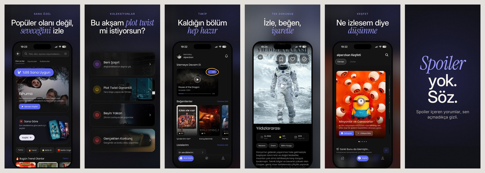

- **Process & craft** - brief, category research, story order, the first three shots, headline patterns,
  banned/tired phrases (EN + TR), layouts, type, colour, emphasis devices, localisation, critique scorecard,
  and up-to-date store specs (checked 2026-11-04).
- **A reference library of 1,718 real screenshots** - the top 4 free iPhone apps in 25 App Store categories
  (Turkish and US stores) plus 2 well-rated small/mid-size "challengers" per category. Every app is labelled
  (layout, techniques, first-shot type, quality, AI smell, why); every screenshot has headline text (355
  human-verified), position, language and colour data. Searchable from the command line; refreshed monthly.
- **Design-driven, not template-driven** - the skill measures the app's **visual DNA** from its real screens
  (and website): palette with roles, fonts, shape language, the signature elements only this app has. From
  that it writes **three app-specific concepts**, and composes every screenshot freely as a **scene** of
  layers - the real screens and crops of them, lifted elements, type, shapes, SVG, hand marks - instead of
  filling one layout. A campaign system (one ground family, one type pairing, one emphasis device, one motif)
  holds the set together while each composition changes. Output: PNGs at every store size plus **editable
  SVGs** (Figma, Illustrator).
- **Truth built into the renderer** - screens come only from an evidence manifest (SHA-256 checked), can't be
  stretched, recoloured, filtered or painted over. Every number on the canvas is checked against the text read
  from the screens the shot shows, and a UI look-alike that isn't cropped from the app gets flagged. Further
  checks: decoration without a motive, colours and fonts outside the campaign, contrast measured on the
  rendered pixels, three shots with the same composition, and Google Play's 20 % text rule.
- **Niche, not generic** - a step that finds the app's *angle* (the exact person, the enemy, the ritual,
  the insider word, the proof only it has), a playbook per category (what the chart does, what the best
  sets do differently, the clichés to avoid, where the room is), and - as a fast path and fallback - **seven
  preset design directions** (editorial, poster, playful, cinematic, crafted, native, utility).
- **Checks that catch a set that looks fine but doesn't sell** - none of the first three headlines saying
  what the app does (`"promise_words"`), the same screen used as proof twice, and thin demo data (the same
  figure repeated on a screen, read with tesseract).
- **Span pairs** - one picture across two screenshots (a phone cut exactly in half by the seam, or one ground
  behind two shots), drawn on a single double-width canvas and split down the middle so the halves always
  line up; the renderer warns when text or a callout crosses the seam, a half has no headline or the pair
  sits where search results cut it. Used once per set, twice only in sets of 8+.
- **Scripts** (Python 3 + Pillow) - read a live store listing, check and clean raw screens (status bar, debug
  UI), place crops on a grid, render a whole set from one JSON spec at exact store sizes (every locale at once,
  every store size - iPhone medium + large, iPhone Duo outer + inner, iPad, Google Play - with the right frame
  for each, Google Play feature graphic, bundled OFL fonts, emphasis words, zoom cards,
  callouts, posters, Turkish-safe capitals), check it against store and copy rules with a search-result
  preview, and peer-test it next to exemplary sets.

## Design-driven pipeline (v2): the Seenfy pilot

```
evidence.py (raw screens, regions, OCR) → dna.py (measure · fonts · board) → three concepts as set files
→ compose.py concepts (checkpoint) → composition brief per shot → compose.py render → xray · check_set · look → fix
```

The pilot was built from Seenfy's raw screens ([`examples/seenfy-v2/`](examples/seenfy-v2/)).

The DNA board shows what was measured and completed:
- dark UI #121212, indigo accent #5460F0;
- Poppins as the closest open match to the app's font;
- flat cards with a large radius;
- the signature elements, cropped from the real screens.

Under it are the three concepts. They differ in their idea, not their colours:
- **A "Sana Uygun"** - the app's indigo pill sets every emphasis word, and the proving element lifts out of the
  screen.
- **B "Ekrandaki Sayı"** - one real datum from the screen, poster-size, opens each shot.
- **C "Açık Sayfa"** - the dark app on its own ink colour, with a progress line that advances through the set.

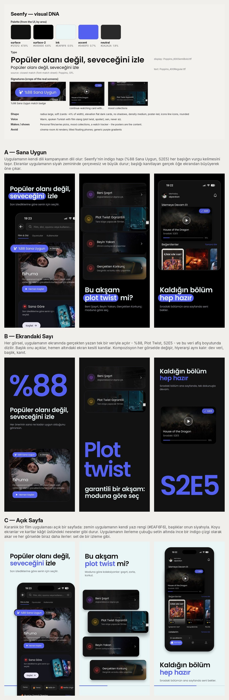

**Concept B was chosen**: %88, Plot twist, S2E5 and 8.5 are all on the app's screens, and nobody in the category
leads with its own numbers.

Every shot keeps the system: ground #121212, Poppins, indigo for data and emphasis. Every shot changes its
composition: where the datum sits, what's biggest, the crop, what lifts out.

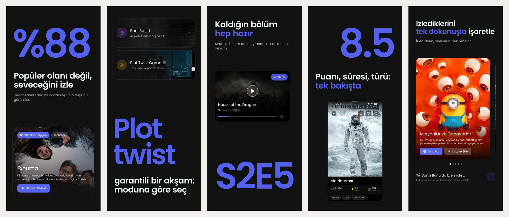

The Google Play variant comes from the same file:
- no device frame;
- big type scaled down, so every word stays within 20 % of the height;
- the feature graphic.

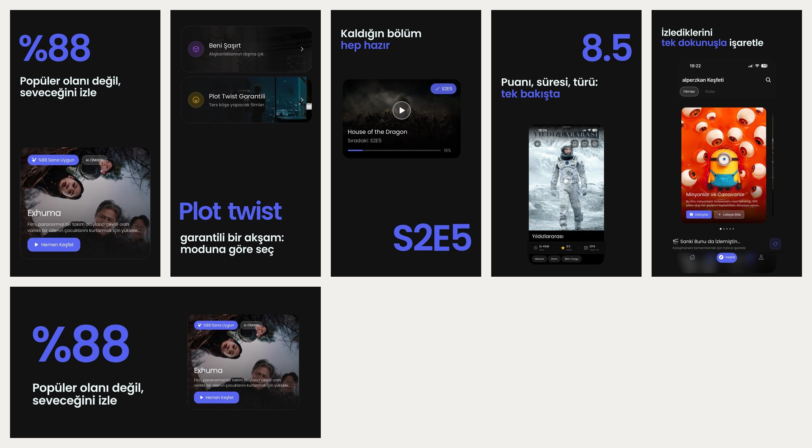

```bash
S=skills/store-screenshots/scripts
python3 $S/compose.py concepts examples/seenfy-v2/concepts/*.json --board dna-board.jpg -o concepts.jpg
python3 $S/compose.py render examples/seenfy-v2/set.json --out out/       # ios, ios-large, android + feature graphic
```

> The Seenfy example screens are 738 px wide, so the renderer warns where a crop is enlarged past 1.8× - real
> captures (1206+ px) don't have that problem.

<details><summary>The bundled scene example (fictional app, <code>templates/scene.example.json</code>, concept "Tek Turuncu")</summary>

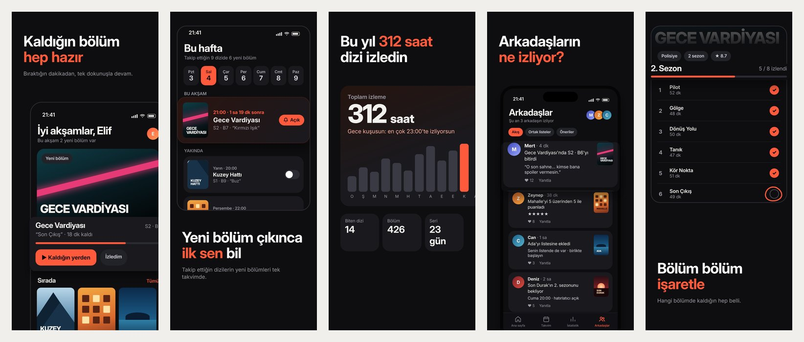

</details>

## Real example: Seenfy (preset route, v1)

[Seenfy](https://apps.apple.com/tr/app/id6764370964) is a Turkish film & TV discovery and tracking app. The set
above was made end to end with the skill:

1. **Intake** - `fetch_listing.py` read the live App Store listing (description, release notes, category,
   current screenshots) and found closer competitors with `--search "film dizi takip"` (Raf, Kare,
   Letterboxd, Bingers, Muvy).
2. **Critique** - the existing set scored **13/20**: strong Turkish voice ("Filmi izledin. Şimdi konuş."), but
   AI-rendered cinema rooms, tilted phones, UI too small to read, two shots on the same screen.
3. **Angle** - three candidates (the film-diary keeper, "the end of *ne izlesek?*", "not what's popular");
   the enemy angle won because the screens prove it: the "%88 Sana Uygun" match score.
4. **Storyboard** - one promise per shot, taken from the listing's own proof points (personal picks, mood
   collections, continue watching, one-tap tracking, spoiler-free comments), then a request for exactly the
   raw screens each shot needs.
5. **Direction** - `concepts.py` rendered shots 1–3 in four directions (below); *cinematic* fits a dark,
   poster-rich film app, and one hand-drawn circle on "S2E5" is the human touch.
6. **Render & check** - 6 raw iPhone screens → `prepare_screens.py` (low-res warning, debug button covered)
   → `render_set.py` with one spec for both languages, App Store and Google Play sizes and a Play feature
   graphic → `check_set.py` for store and copy rules, `peer_test.py` next to exemplary sets.

**Concept sheet** - same copy and screens, four directions (cinematic · editorial · poster · crafted):

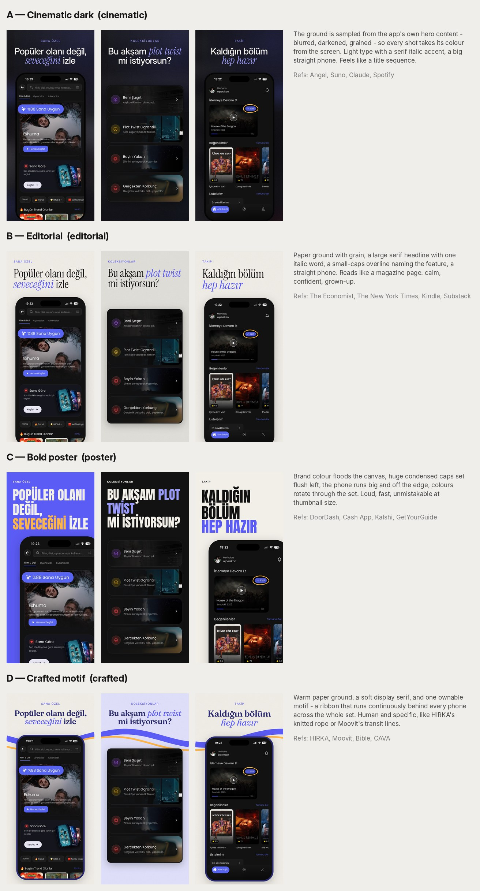

**Turkish (App Store TR)**

| # | Headline | Proof on screen |
|---|---|---|
| 1 | Popüler olanı değil, *seveceğini* izle | "%88 Sana Uygun" match score, pulled out |
| 2 | Bu akşam *plot twist* mi istiyorsun? | Mood collections |
| 3 | Kaldığın bölüm *hep hazır* | Continue watching, S2E5 circled by hand |
| 4 | İzle, beğen, *işaretle* | Watchlist / like / watched buttons |
| 5 | Ne izlesem diye *düşünme* | Discover |
| 6 | *Spoiler* yok. Söz. | Poster: spoiler comments stay hidden |

**English** - rewritten, not translated:

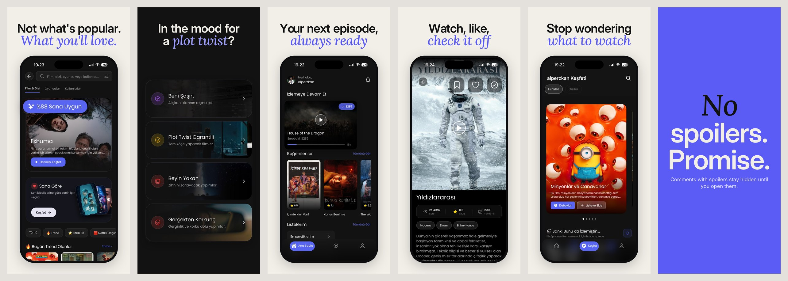

*Not what's popular. What you'll love. · In the mood for a plot twist? · Your next episode, always ready ·
Watch, like, check it off · Stop wondering what to watch · No spoilers. Promise.*

**Google Play** - same spec: the bare rounded screen (Google advises against device imagery), the poster shot
left out (`"stores": ["ios"]` - Play wants in-app screenshots), plus the required 1024×500 feature graphic:

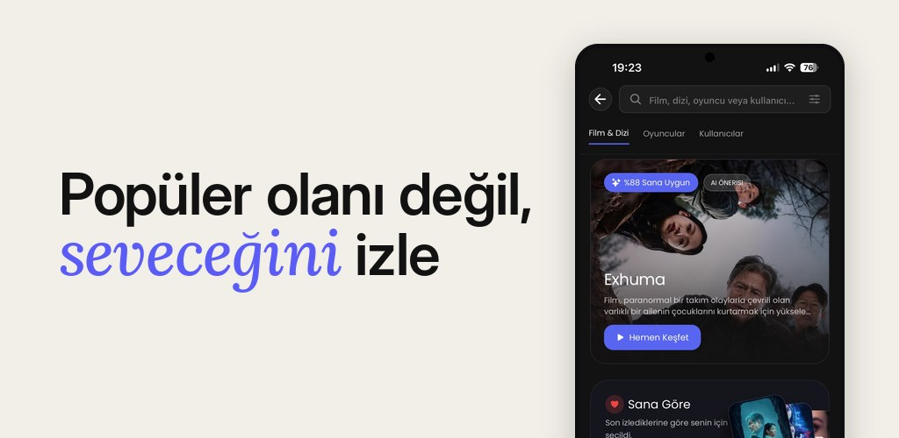

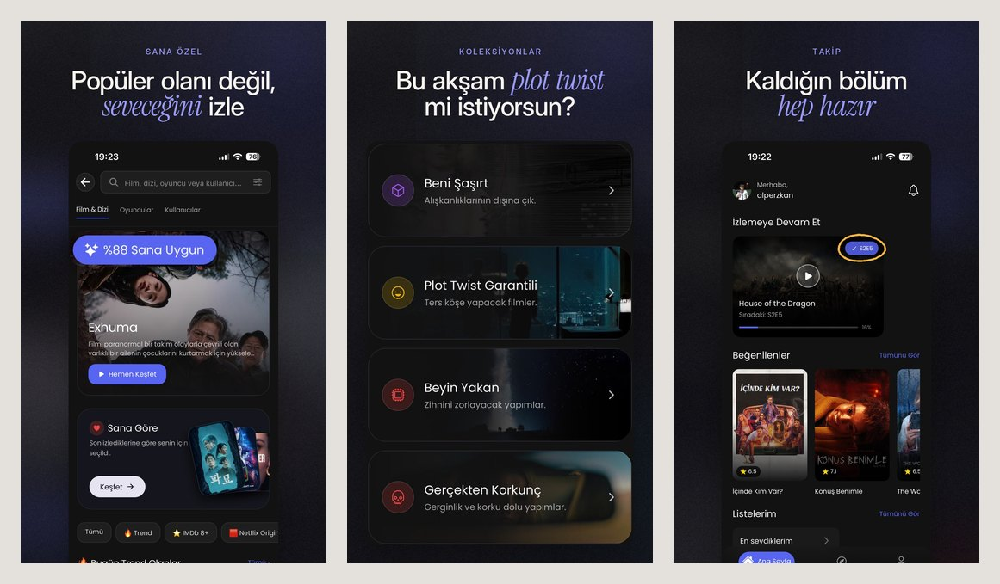

> The English set reuses the Turkish UI to show the copy side by side. For a real US listing, capture the
> screens with the app in English - caption language should always match the UI (`references/localization.md`).

Reproduce everything (TR + EN; iPhone 1206×2622 + 1320×2868, Google Play 1080×1920 + feature graphic) from one spec:
`python3 skills/store-screenshots/scripts/render_set.py examples/seenfy/set.json --out out/` → `out/tr/…`,
`out/en/…`. The spec and screens are in `examples/seenfy/`.

**Span pairs** - shots 2-3 share one phone across the seam (bridge), 6-7 share one ground and a motif line
(pair). The gap between them is the gap the store shows (`tools/fixtures/span-set.json`, demo app):

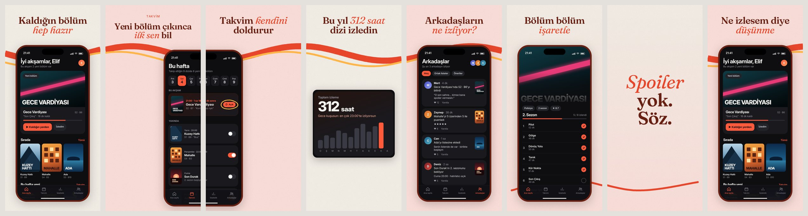

<details><summary>The skill's own demo set (fictional app, from <code>templates/set.example.json</code>)</summary>

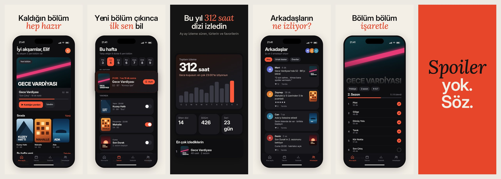

</details>

## Store sizes

One spec renders every store the app is on (`"sizes"`), checked against Apple's and Google's pages on
2026-11-04 (`references/store-specs.md`):

| Preset | Pixels | Notes |
|---|---|---|
| `ios` | 1206 × 2622 | iPhone, Dynamic Island medium - **required** |
| `ios-large` | 1320 × 2868 | iPhone, Dynamic Island large - render with `ios` (otherwise Apple wants Face ID large) |
| `duo-outer` · `duo-inner` | 1398 × 2034 · 2007 × 2853 | iPhone Duo - required from April 2027 for iOS 27.1 SDK apps; needs Duo screens |
| `ipad` | 2064 × 2752 | iPad 13" - required if the app runs on iPad |
| `android` | 1080 × 1920 | Google Play, 9:16, promotion-eligible; plus the 1024 × 500 feature graphic |

Screens, crops and anything else can differ per size (`{"default": …, "duo-inner": …}`), a shot can be limited
to one store (`"stores": ["ios"]`), and wider canvases (Duo, iPad) get type and spacing scaled to their shape.

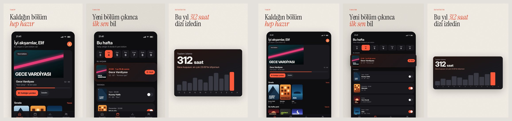

## Full vs lite

| Package | Contents | Size | Use for |
|---|---|---|---|
| `store-screenshots.zip` | everything, all 1,619 library images | ~46 MB | Claude Code, Codex, Cursor, Gemini CLI, cloning the repo |
| `store-screenshots-lite.zip` | full text catalog + 661 images at 420 px (every shot of the exemplary apps, the first shot of every app, shots 1–3 of instructive bad ones) | ~16 MB (18 MB unpacked) | claude.ai and ChatGPT uploads |

Both work the same way; the scripts only offer images that are on disk. Build them with
`python3 tools/package_skill.py` (writes `dist/`).

## Install

The skill is the folder `skills/store-screenshots` - the one with `SKILL.md` in it. Wherever it goes, that
folder must end up as `<skills folder>/store-screenshots/SKILL.md`: not one level deeper, and not under
another name.

**Claude Code - plugin marketplace** (also works while the repository is private)
```
/plugin marketplace add thearkxd/store-screenshots-skill
/plugin install store-screenshots@store-screenshots-skill
```
- **Private repository:** Claude Code clones with the git credentials already on your machine. Run
  `gh auth login` and then `gh auth setup-git` once.
- **A branch:** add `#<branch>`, for example `thearkxd/store-screenshots-skill#v2-design-driven`.
- **Updates:** run `/plugin marketplace update store-screenshots-skill`, or turn on auto-update under `/plugin` →
  Marketplaces. A new copy arrives when the version in `.claude-plugin/plugin.json` changes.

**Claude Code - clone once, update with `git pull`** (the easiest way to follow a branch)

macOS / Linux:
```bash
git clone https://github.com/thearkxd/store-screenshots-skill.git ~/code/store-screenshots-skill
mkdir -p ~/.claude/skills
ln -s ~/code/store-screenshots-skill/skills/store-screenshots ~/.claude/skills/store-screenshots
```
Windows (PowerShell). Write `$HOME`, not `~`: Windows PowerShell passes `~` to `git` unexpanded, and git then creates a
folder literally named `~`.
```powershell
git clone https://github.com/thearkxd/store-screenshots-skill.git "$HOME\code\store-screenshots-skill"
New-Item -ItemType Directory -Force "$HOME\.claude\skills" | Out-Null
New-Item -ItemType Junction -Path "$HOME\.claude\skills\store-screenshots" -Target "$HOME\code\store-screenshots-skill\skills\store-screenshots"
```
- A junction needs no admin rights. `ln` doesn't exist in PowerShell.
- If you use another config folder (`CLAUDE_CONFIG_DIR`, for example `.claude-second`), put that name in place
  of `.claude`.
- If a copied `store-screenshots` folder is already in `skills`, delete it first.
- To update, run `git pull` in the clone. To switch branches, run `git checkout <branch>`. The next session
  loads the new files.

**Claude Code - from the release zip:** `store-screenshots.zip` holds one folder, `store-screenshots/`. Extract
it straight into your skills folder (`~/.claude/skills/`). Windows' "Extract All" adds a folder named after the
zip (`store-screenshots\store-screenshots\SKILL.md`), which is one level too deep. Pick the skills folder
itself as the target, or move the inner folder up.

**claude.ai / Claude desktop** - download `store-screenshots-lite.zip` from Releases and upload the zip as it
is, without extracting it, in the Skills section of your settings (custom skills need code execution enabled).

**ChatGPT** - Skills → Create → Upload from your computer, and pick `store-screenshots-lite.zip`. (Skills
availability depends on your ChatGPT plan and workspace settings.)

**Codex CLI, Gemini CLI, Cursor and others** - copy or link `skills/store-screenshots` into your agent's skills
folder (for example `~/.codex/skills/`, `~/.gemini/skills/` or `~/.agents/skills/`), the same way as above.

**A branch that isn't released yet:** branches don't publish releases. Open the branch's run under Actions →
"Build & release" and download the artifact `store-screenshots-<commit>`. That zip holds both packages,
`store-screenshots-lite.zip` and `store-screenshots.zip`: extract it once and use the inner zip as above.
Artifacts are kept for 14 days.

Skills don't sync between products - install in each one you use. After installing, run the checklist in
[`docs/testing.md`](docs/testing.md) once to make sure the skill triggers and the scripts run there.

## Use

The skill starts by asking whether the app is already live. **Live:** send the App Store / Google Play
link(s) - it reads the listing (description, what's new, category, rating, current screenshots, competitors),
drafts the brief, scores the current set, and then asks for exactly the raw screens the new storyboard needs.
**Not live:** it asks a short form instead (what it does, for whom, what it does better, brand).

Just ask, in any language:
- "Şu uygulama için yeni mağaza görselleri yap: https://apps.apple.com/tr/app/…/id6764370964"
- "Henüz yayında olmayan bir bütçe uygulaması için mağaza görselleri hazırla."
- "Critique our Play Store screenshots and tell me the three biggest fixes."
- "What do the best finance apps put in their first screenshot?"
- "Bu İngilizce başlıkları Türkçe'ye uyarla."

Or run the tools yourself:
```bash
S=skills/store-screenshots/scripts
python3 $S/search_library.py --category weather --summary
python3 $S/search_library.py --quality exemplary --position 1 --verified --format headlines
python3 $S/fetch_listing.py https://apps.apple.com/tr/app/id6764370964 --search "film dizi takip"
python3 $S/prepare_screens.py examples/seenfy/screens --out prepared --status-bar 9:41
python3 $S/crop_helper.py check examples/seenfy/set.json -o crops.jpg
python3 $S/concepts.py examples/seenfy/set.json -o concepts.jpg        # 3 directions for the category
python3 $S/concepts.py --list                                          # all seven directions
python3 $S/render_set.py examples/seenfy/set.json --out out/            # preset route
python3 $S/evidence.py build examples/seenfy/screens -o evidence.json     # design route: evidence → DNA → scenes
python3 $S/dna.py measure evidence.json --app Seenfy -o dna.json
python3 $S/compose.py render examples/seenfy-v2/set.json --out out-v2/
python3 $S/check_set.py out/tr/ios --store ios --lang tr
python3 $S/check_set.py out/tr/android --store android --lang tr
python3 $S/peer_test.py out/tr/ios --category entertainment -o peer.jpg
```

## What's inside

```
skills/store-screenshots/
  SKILL.md                    workflow, non-negotiables, red flags, tool map
  references/                 intake · angle · design-process · scene-format · categories · directions ·
                              copy-rules · storytelling · layouts · anti-ai · localization · store-specs ·
                              critique · library-guide
  scripts/                    evidence · dna · compose · scene · validate (design route) ·
                              fetch_listing · prepare_screens · crop_helper · search_library · concepts ·
                              render_set · design · check_set · peer_test · make_sheet · collect_examples ·
                              find_challengers · build_catalog
  templates/                  scene.example.json + scene-evidence.json (design route), set.example.json
                              (preset route), demo screens of a fictional app
  assets/directions/          the seven design directions (JSON presets with brand tokens)
  assets/fonts/               10 OFL families - Inter, Instrument Serif, Fraunces, Anton, Baloo 2, Space Grotesk,
                              Bricolage Grotesque, Caveat, JetBrains Mono, Store Serif (Lora) - subset to Latin + Turkish
  assets/library/             catalog.json · classifications.json · stats.json · img/
examples/seenfy/              a real set: one multi-locale spec (TR + EN) and the raw screens
examples/seenfy-v2/           the design-route pilot: evidence, DNA, three concepts, the chosen set, Poppins (OFL)
evals/evals.json              test prompts with expected behaviour
docs/testing.md               manual checklist for claude.ai / ChatGPT / Claude Code
tools/package_skill.py        builds the full and lite zips
tools/smoke_test.py           what CI runs on every push
tools/library_diff.py         monthly refresh: new / dropped chart apps vs. the library
tools/demo_screens/build.py   rebuilds the demo screens (HTML/CSS → Playwright)
```

## Library at a glance

- 25 categories × 4 chart apps × 2 stores + 50 US challengers (rating ≥ 4.6, not a giant seller), collected
  2026-11-04 from the public App Store.
- Chart apps: 42 rated exemplary, 79 solid, 52 weak; 22 flagged for AI/template smell. Challengers: 9
  exemplary (Working Copy, TickPick, CAVA, Tunesimo, Structured, GetYourGuide, Viator, Weather & Radar,
  The Economist).
- Strongest signals in the data: verb-led headlines (11 exemplary / 0 weak apps), one emphasised word (11/1),
  pulled-out UI cards (4/0) - versus generic claims (0/16), no captions (0/15), tilted floating phones (0/12).
- Quality labels are a reviewer's judgement (made with Claude), not conversion data. See
  `references/library-guide.md` for method, limits and biases.

Refresh or extend the library with `collect_examples.py` + `build_catalog.py` (needs access to
`itunes.apple.com` and `is1-ssl.mzstatic.com`, Pillow and tesseract with `eng` + `tur`).
`.github/workflows/library-refresh.yml` does the collecting on the 3rd of every month and opens an issue with
the new apps to classify.

## Releases (CI/CD)

`.github/workflows/release.yml` runs on every push: it installs Pillow, resvg-py and tesseract, runs
`tools/smoke_test.py` (every script, example renders on both backends, the truth and store checks) and builds both zips with `tools/package_skill.py` - which fails the
build if the lite package grows past 20 MB. Pushes to `main` then publish a GitHub release with both zips.

- Version: `major.minor` comes from `.claude-plugin/plugin.json`, the patch number is the workflow run
  (`v1.0.7`, `v1.0.8`, …). Bump `version` there for a new minor/major line.
- Other branches and pull requests: the zips are attached to the workflow run as artifacts (14 days).
- Put `[skip release]` in a commit message to build without publishing.
- `network-test.yml` fetches a real App Store and Google Play listing weekly (and when `fetch_listing.py`
  changes), so parser breakage shows up without blocking releases.

## License

Code, reference texts and classification data: MIT. Bundled fonts: SIL OFL 1.1 (`assets/fonts/`). **The screenshots in the library belong to their
publishers** and are included for study only - see [NOTICE.md](NOTICE.md).

---

### Türkçe özet

App Store ve Google Play mağaza görselleri için bir skill: uygulamanın vaadini bulur, gerçek ekranlardan yola
çıkar, "değiştirme testinden" geçen ve yapay zekâ kokmayan başlıklar yazar, görselleri mağaza ölçülerinde
PNG olarak üretir ve kontrol eder. İçinde Türkiye ve ABD App Store'larında 25 kategoriden en popüler
uygulamaların 1.718 mağaza görseli var; her uygulama iyi/kötü ve nedeniyle etiketli. Her kategori için bir
oyun kitabı, uygulamanın niş "açısını" bulan bir adım ve yedi tasarım yönü (editoryal, poster, oyuncu,
sinematik, el yapımı, native, veri) var: render'dan önce ilk üç görsel üç farklı yönde yan yana gösterilir. claude.ai ve ChatGPT
için 20 MB altındaki **lite** paketi, Claude Code ve diğer ajanlar için **tam** paketi kullanın.

İki görselin tek görsel gibi durduğu "span" çiftleri de var: çift genişlikte tek tuval çizilip ortadan
bölünür, böylece iki yarı her zaman hizalı olur; sette en fazla bir (8+ görselde iki) kez kullanılır.

**Şablon değil, tasarım:** skill önce uygulamanın gerçek ekranlarından (ve varsa web sitesinden) görsel
DNA'sını çıkarır: renk rolleri, font, şekil dili, yalnızca bu uygulamada olan imza öğeler. Sonra uygulamaya özel
üç konsept yazar ve her görseli mesajına göre serbest bir sahne olarak kurar. Sahnede gerçek ekranlar ve kesitleri,
öne çıkan öğeler, tipografi, şekiller, SVG ve el işaretleri yer alır. Seti kampanya sistemi bir arada tutar:
tek zemin ailesi, tek font eşleşmesi, tek vurgu, tek motif. Gerçek ekranlar esnetilemez, renklendirilemez, üstü
boyanamaz; ekranda olmayan bir sayı başlığa yazılırsa uyarı verir. Çıktı: her mağaza ölçüsünde PNG ve Figma'da
düzenlenebilir SVG. Pilot: `examples/seenfy-v2/`. Yedi hazır yön artık hızlı yol ve yedek.

Gerçek örnek: yukarıdaki Seenfy seti skill ile baştan sona üretildi (mağaza sayfası okundu, eski set 13/20
aldı, storyboard çıkarıldı, 6 ham ekranla render edildi). Türkçe ve İngilizce spec'ler `examples/seenfy/`
klasöründe.
